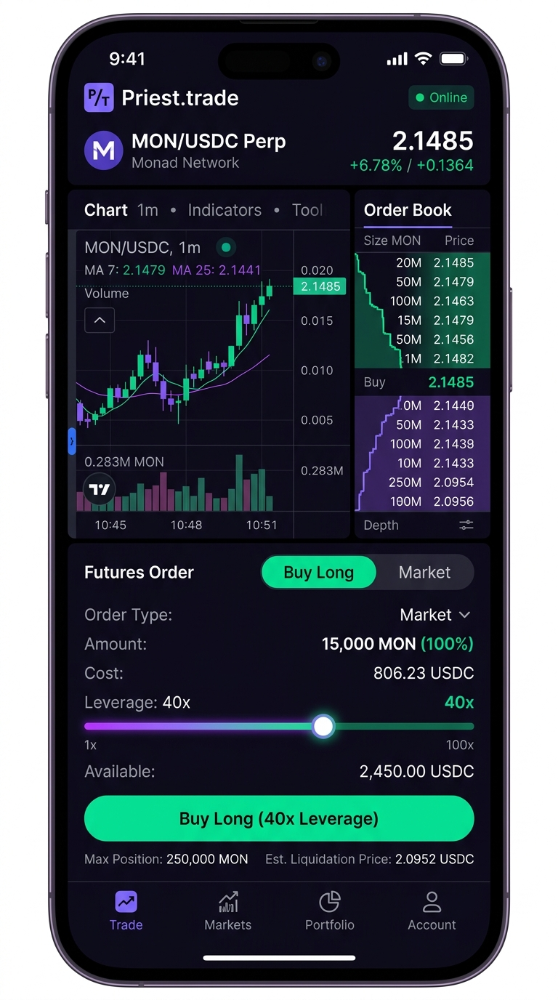
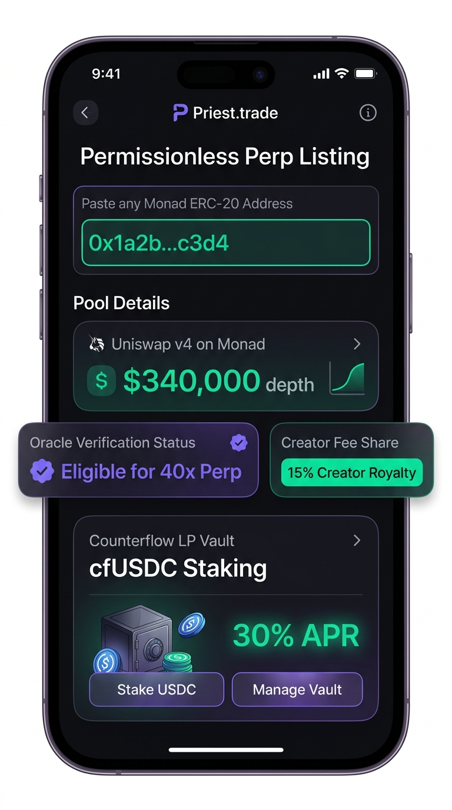
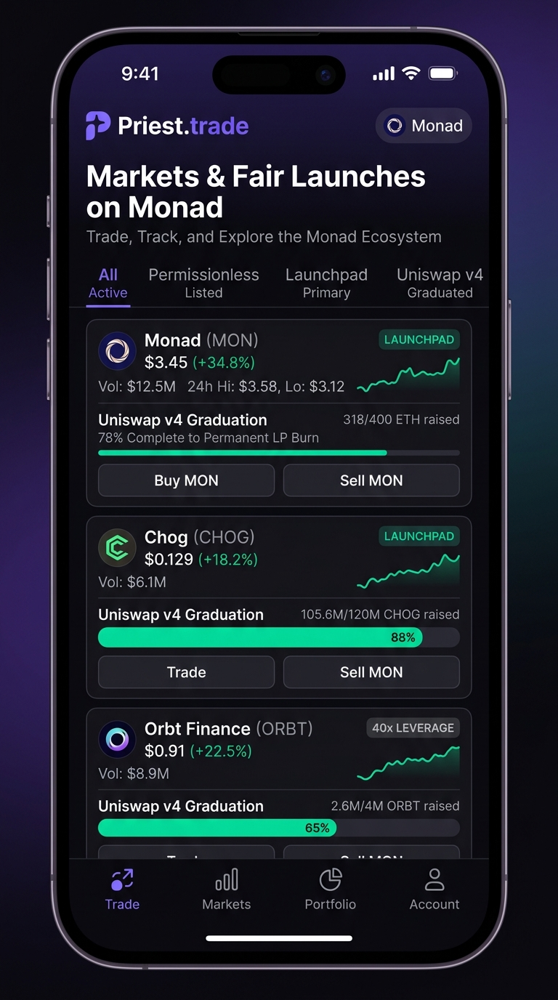

# Priest.trade — Monad Metropolis Hackathon Submission

> **Permissionless perpetual markets for any token on Monad — instant leverage from block zero & permissionless listing for existing tokens.**

Priest.trade is the Monad-native perpetuals exchange and launchpad. It enables **anyone to list any token on Monad into a live perpetual futures market permissionlessly**, while also featuring a complete **fair-launch token launchpad** where new coins trade with instant leverage from day one and graduate into locked **Uniswap v4** spot liquidity backed by an automated LP vault (**Counterflow**).

[](https://monadvision.com/address/0xdCb4FbCdebBeB3C3D1233EDDBFE21e086acE923d)
[](https://testnet.monadexplorer.com/address/0x041f3b8A1874E8ceBa41C29782Baba20B38F9c35)
[](https://soliditylang.org/)
[](https://getfoundry.sh/)
[](LICENSE)

---

## 🏛️ The Problem & Our Solution

Traditional perpetual DEXes only support a curated allowlist of high-market-cap blue chips, leaving long-tail Monad tokens without leverage, hedging, or shorting capabilities. Meanwhile, conventional token launchpads end at bonding curves with zero leverage, leaving communities vulnerable to pump-and-dump cycles with no way to hedge.

**Priest.trade solves both challenges on Monad:**

### 1. Permissionless Token Listing (Any Monad Token)
Calling `listMarket(token, params)` opens a live perpetual futures market for any existing Monad token in a single on-chain transaction:
- **Zero Gatekeeping:** No team approval, no governance delays, and zero listing fee by default.
- **Real Spot Liquidity Grounding:** Requires an existing Uniswap **v3** (from the configured factory) or hookless **v4** pool against USDC or WMON with at least **$25k** pool depth.
- **Oracle Worst-Of Fill Protection:** Trades execute at the worse of the on-chain oracle and pool price ($\max$ for buys, $\min$ for sells), mathematically preventing oracle manipulation and MEV front-running.
- **Lister Incentives:** The wallet that lists the token earns the creator share of trading fees.
- **Isolated Counterflow LP Vault:** Each listed market spawns its own ERC-4626 vault (`cfUSDC`) that anyone can fund to act as counterparty and earn yield.
- **Controlled Warmup:** Starts with up to **10x** leverage (configurable up to 40x) with a 10-minute warmup while oracle history establishes.

### 2. Fair-Launch Perpetuals Launchpad (Primary Stage)
For brand-new tokens, Priest.trade provides an end-to-end fair-launch system with instant leverage:
- **Block-Zero Perpetual Trading:** New tokens launch directly with a perpetual futures market on a virtual AMM curve ($x \cdot y = k$).
- **Zero Creator Pre-Mine:** 100% of the token supply is minted directly into the engine at creation.
- **Up to 40x Leverage:** Initial 24-hour warmup capped at 10x leverage to prevent launch sniping, unlocking up to 40x as the market matures.
- **Continuous EWMA Funding:** Funding rates adjust continuously based on open-interest skew and price divergence.

### 3. Permanent Uniswap v4 Graduation (Secondary Stage)
When a launchpad token proves authentic conviction by clearing **5 on-chain graduation gates** ($2M volume, 50 unique traders, funding stability, 7+ days resilience, fair-launch lock):
- **Uniswap v4 Spot Seeding:** The engine automatically seeds a full-range Uniswap v4 spot liquidity pool using protocol collateral.
- **Permanent LP Burn:** The Uniswap v4 LP position NFT is transferred directly to `0x000000000000000000000000000000000000dEaD`, permanently eliminating liquidity rug pulls.
- **Supply Burn:** All remaining unminted token reserves are burned forever.
- **Transition to Secondary Rail:** The perpetual market transitions seamlessly to the secondary oracle rail, trading against the newly seeded spot pool with worst-of fills and Counterflow vault backing.

### 4. Counterflow LP Vault (`cfUSDC`)
An automated ERC-4626 liquidity vault that serves as counterparty for secondary and listed markets:
- Anyone can deposit USDC to back traders and earn **30% of platform trading fees** plus market surplus.
- Risk-isolated per market with a **10% per-market exposure cap** and a **3-day withdrawal cooldown**.

---

## ⚡ Why Monad?

Priest.trade is engineered from the ground up for Monad's architecture:
- **10,000 TPS & 1-Second Block Times:** Sub-second trade execution, responsive funding rate adjustments, and prompt liquidations.
- **Asynchronous Execution & MonadDb:** High-performance disk state access allows continuous EWMA funding index accumulation without state bottlenecks.
- **Sub-Cent Gas Fees:** Micro-adjustments (like on-chain TP/SL repositioning and partial fills) are economically practical.

---

## 📐 Architecture

```
                                 PRIEST.TRADE
                                      │
              ┌───────────────────────┴───────────────────────┐
              ▼                                               ▼
   [ LIST EXISTING TOKEN ]                         [ LAUNCH NEW TOKEN ]
   • Any Monad ERC-20 token                        • 100% supply minted to engine
   • Requires Uniswap v3/v4 pool (>= $25k)         • Zero creator pre-mine
   • Calls listMarket() permissionlessly           • Instant perp market from block zero
   • Lister earns creator fee share                • Primary Stage: virtual curve (vAMM)
              │                                    • Up to 40x leverage (10x warmup)
              │                                               │
              │                                               │ Clears 5 Gates:
              │                                               │ $2M Vol, 50 Traders, Stability,
              │                                               │ 7+ Days Age, Fair-Launch Lock
              │                                               ▼
              │                                    [ UNISWAP v4 GRADUATION ]
              │                                    • Seeds full-range Uniswap v4 pool
              │                                    • LP NFT burned to 0x...dEaD
              │                                    • Unminted tokens burned
              │                                               │
              └───────────────────────┬───────────────────────┘
                                      ▼
                        [ SECONDARY MARKET ENGINE ]
                        • On-chain Uniswap v4 EMA / v3 TWAP
                        • Worst-of execution pricing (slippage immunity)
                        • Skew premium + 10 bps spread
                        • Backed by Counterflow LP Vault (cfUSDC)
```

---

## 🚀 Launchpad Mechanics (Primary & Secondary Stages)

### Primary Stage: Virtual AMM ($x \cdot y = k$)
New tokens launched through Priest.trade start on the **Primary Engine**:
- **Virtual Reserves:** Pricing is driven by virtual liquidity reserves ($x \cdot y = k$), providing deep liquidity from the very first dollar deposited.
- **Warmup Protection:** Maximum leverage is capped at 10x for the first 24 hours to prevent flash-loan attacks and launch sniping, expanding to 40x as liquidity deepens.
- **EWMA Funding Rate:** Longs pay shorts when market price exceeds the index price, and vice versa, balancing open interest.

### The 5 Graduation Gates
To graduate into a permanent Uniswap spot pool, a primary market must clear five verifiable on-chain criteria:
1. **Volume Threshold:** Cumulative perpetual trading volume $\ge \$2,000,000$.
2. **Trader Diversity:** At least 50 unique non-Sybil trader wallets.
3. **Funding Rate Stability:** Funding rate remains within normal bounds over a multi-day observation window.
4. **Time & Resilience:** Minimum 7 days of active trading history to prove sustained interest.
5. **Fair-Launch Security Lock:** All fair-launch criteria and collateral checks verified.

### Secondary Stage: Uniswap v4 & Permanent LP Burn
Upon graduation:
1. The engine deploys accumulated protocol USDC and base tokens to seed a full-range **Uniswap v4** pool.
2. The Uniswap v4 position NFT is permanently burned by transferring it to `0x000000000000000000000000000000000000dEaD`.
3. All remaining unminted token reserves are burned.
4. The market switches from the vAMM curve to the **Secondary Rail**, executing against real spot pool TWAPs with worst-of fills and Counterflow vault backing.

---

## 📱 Priest.trade Mobile (iOS & Android)

Priest.trade includes a full-featured cross-platform mobile application engineered with **React Native** and **Expo** for high-performance mobile perpetuals trading on Monad:

- **Permissionless Listing On-the-Go:** Paste any Monad ERC-20 contract address to verify Uniswap v3/v4 pool depth and launch a live perp market in seconds.
- **Mobile Perpetuals Terminal:** Interactive candlestick charts, real-time order book depth, 40x leverage slider, and one-tap TP/SL trigger configuration.
- **Counterflow Vault Staking:** Deposit USDC into isolated ERC-4626 `cfUSDC` vaults to earn protocol fee yield directly from your phone.
- **Non-Custodial & Social Logins:** Connect seamlessly via MetaMask, Rabby, Privy social login, or hardware wallets.

<p align="center">
  
  
  
</p>

---

## 📜 Deployed Contracts

### Monad Mainnet (Chain ID: `143`)

| Contract | Address | Explorer Link |
|---|---|---|
| **PerpesEngine (Proxy)** | `0xdCb4FbCdebBeB3C3D1233EDDBFE21e086acE923d` | [MonadVision](https://monadvision.com/address/0xdCb4FbCdebBeB3C3D1233EDDBFE21e086acE923d) |
| **PerpesEngine (Implementation)** | `0x6CF8964546FB6292081Ab6AE4DCAc39871A6BB63` | [MonadVision](https://monadvision.com/address/0x6CF8964546FB6292081Ab6AE4DCAc39871A6BB63) |
| **CounterflowVault (`cfUSDC`)** | `0x7AA4Bc202A7FB54766b83D8a01046248D1b250F1` | [MonadVision](https://monadvision.com/address/0x7AA4Bc202A7FB54766b83D8a01046248D1b250F1) |
| **Native Circle USDC** | `0x754704Bc059F8C67012fEd69BC8A327a5aafb603` | [MonadVision](https://monadvision.com/address/0x754704Bc059F8C67012fEd69BC8A327a5aafb603) |
| **Uniswap v4 PoolManager** | `0x188d586Ddcf52439676Ca21A244753fA19F9Ea8e` | [MonadVision](https://monadvision.com/address/0x188d586Ddcf52439676Ca21A244753fA19F9Ea8e) |
| **Uniswap v4 PositionManager** | `0x5b7eC4a94fF9beDb700fb82aB09d5846972F4016` | [MonadVision](https://monadvision.com/address/0x5b7eC4a94fF9beDb700fb82aB09d5846972F4016) |
| **Uniswap v3 Factory** | `0x204FAca1764B154221e35c0d20aBb3c525710498` | [MonadVision](https://monadvision.com/address/0x204FAca1764B154221e35c0d20aBb3c525710498) |
| **Burn Address** | `0x000000000000000000000000000000000000dEaD` | Permanent LP & Token Burn |

### Monad Testnet (Chain ID: `10143`)

| Contract | Address | Explorer Link |
|---|---|---|
| **PerpesEngine (Proxy)** | `0x041f3b8A1874E8ceBa41C29782Baba20B38F9c35` | [Testnet Explorer](https://testnet.monadexplorer.com/address/0x041f3b8A1874E8ceBa41C29782Baba20B38F9c35) |
| **CounterflowVault (`cfUSDC`)** | `0x0cDa05B16734793AeF452C983bE5773c720Da471` | [Testnet Explorer](https://testnet.monadexplorer.com/address/0x0cDa05B16734793AeF452C983bE5773c720Da471) |
| **MockUSDC (Faucet)** | `0x534EEE2DC77854015A398B9DD6872eF1498B6764` | Public faucet for testnet trading |

---

## 🛡️ Security & Audit Hardening

The core engine was subjected to an extensive internal security review and static analysis (documented in [`contracts/AUDIT.md`](contracts/AUDIT.md)):

- **H-1 Resolved (Carried Funding Debt):** Unpaid funding exceeding collateral is carried on-chain rather than forgiven, preventing unbacked credits.
- **M-1 Resolved (Vault Headroom Caps):** Payouts and collateral withdrawals are strictly bounded by $\text{Vault} - (\text{Insurance} + \text{Unclaimed Fees})$, ensuring reserved funds can never be withdrawn by winning trades.
- **M-2 Resolved (Blacklist Resilience):** Implemented `_payOrDefer` to ensure blacklisted addresses cannot block keeper liquidations or trigger stops.
- **M-3 Resolved (Emergency Pause):** `setTradingPaused` freezes new opens and limit placements while **always permitting position closes and margin withdrawals**.
- **Solvency Invariant:** Rigorously asserted in Foundry fuzzing tests:
  $$\text{Engine USDC Balance} = \sum(\text{VaultBalance} + \text{OrderEscrow})$$

---

## 📦 Repository Structure

- **`mobile/`**: React Native & Expo cross-platform mobile trading terminal for iOS and Android.
  - `src/app/`: Expo Router screens (Trading, Permissionless Listing, Counterflow Vault, Launchpad).
  - `src/components/`: Real-time orderbook, interactive candlestick charts, and leverage slider.
  - `src/hooks/`: Monad-native wallet, market state, and position management.
- **`contracts/`**: Complete Solidity smart contracts, Foundry scripts, and test suite.
  - `src/PerpesEngine.sol`: The core perpetuals engine, vAMM, permissionless listing, and secondary orchestrator.
  - `src/CounterflowVault.sol`: The ERC-4626 `cfUSDC` LP vault.
  - `src/PerpesToken.sol`: Fair-launch ERC-20 token contract.
  - `src/PerpesOracle.sol` & `PerpesSecondaryMath.sol`: On-chain oracle & worst-of fill math.
- **`apps/`**: Monad-native backend microservices.
  - `apps/indexer/`: Real-time block listener and event indexer using Viem, PostgreSQL, and Redis.
  - `apps/keeper/`: Automated keeper daemon for funding settlement sweeps, liquidations, and TP/SL execution.
  - `apps/liquidity-bot/`: Automated testnet simulation and break-even market-making engine.
  - `apps/candle-engine/`: Real-time OHLCV candlestick aggregation engine.
- **`packages/`**:
  - `packages/evm/`: Viem chain configurations, ABI typings, and deployment loaders.
  - `packages/types/`: Shared TypeScript models.
  - `packages/offchain/`: Shared logging, PostgreSQL pool, and Redis utilities.
  - `packages/config/`: Monorepo configurations (ESLint, Prettier, tsconfig).
- **`docs/`**: Complete GitBook documentation covering getting started, core concepts, trading, launchpad, vaults, rewards, and API.

---

## 🛠️ Local Development & Testing

### Prerequisites
- [Foundry](https://getfoundry.sh/) (`forge`, `cast`)
- Node.js >= 20 & `pnpm`

### 1. Install & Build Contracts
```bash
cd contracts
./install-deps.sh
forge build
forge test
```

### 2. Fork Testing on Monad Mainnet
```bash
MONAD_MAINNET_FORK_RPC=https://rpc.monad.xyz forge test --match-contract MonadForkTest
```

### 3. Install Monorepo Dependencies
```bash
pnpm install
pnpm build
```

### 4. Run Mobile Application
```bash
cd mobile
pnpm install
pnpm start
```

---

## 🏆 Metropolis Hackathon Submission Team

- **Project:** Priest.trade
- **Live Platform:** [priest.trade](https://priest.trade)
- **Developer Documentation:** [docs.priest.trade](https://docs.priest.trade) / `docs/`
